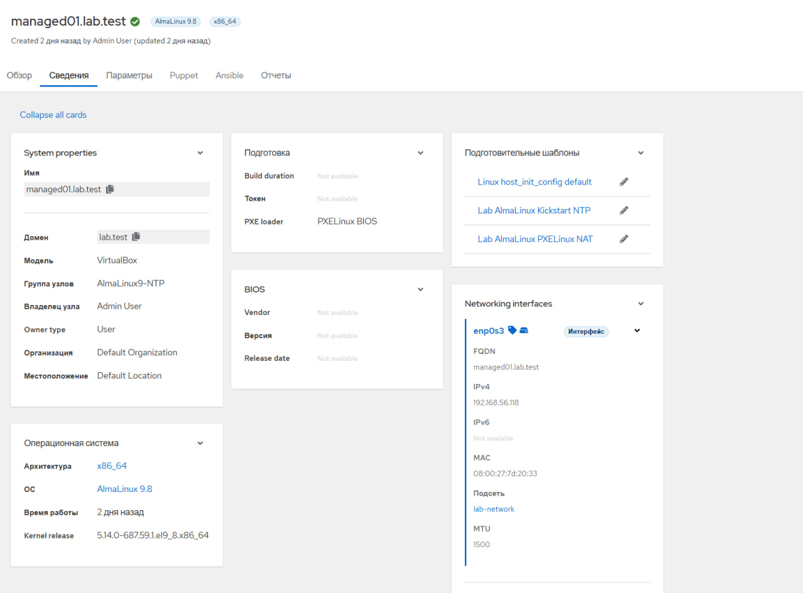
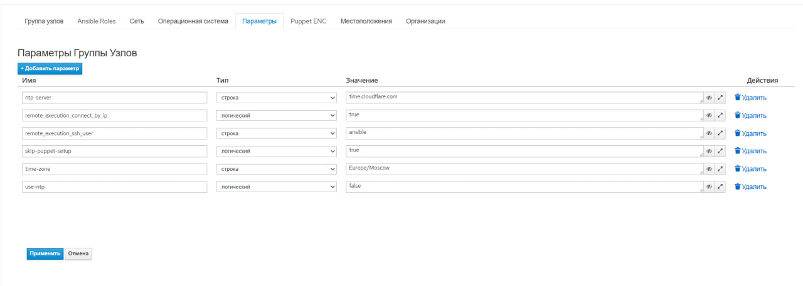
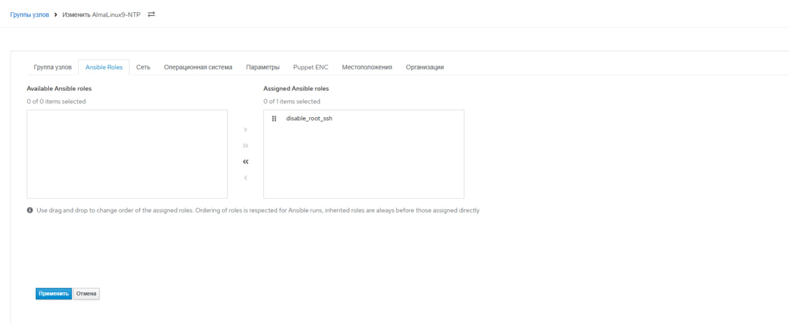
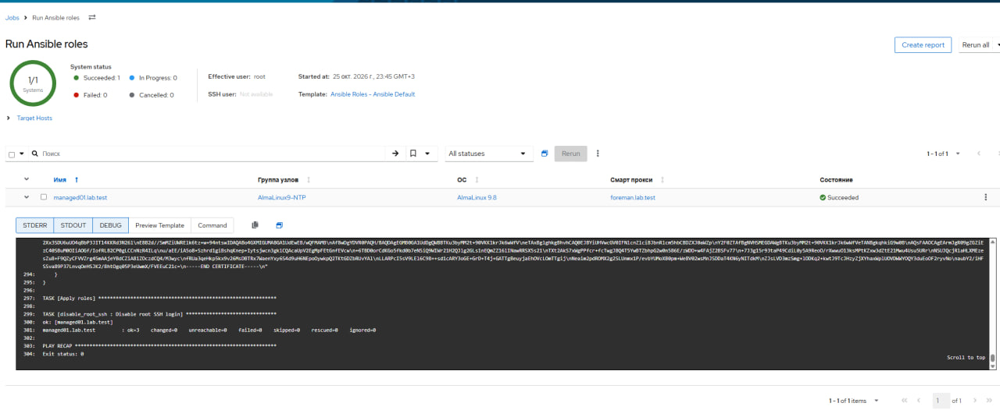
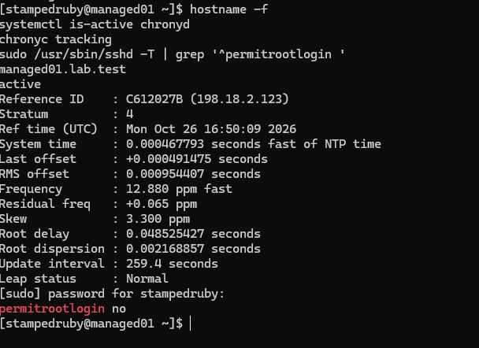

# Настройки Foreman и результаты проверки

## Управляемый хост

Хост managed01.lab.test входит в группу AlmaLinux9-NTP.
Указаны AlmaLinux 9.8 и шаблоны установки и сетевой загрузки.

## Параметры группы

В группе задан сервер времени time.cloudflare.com.
Для удалённого подключения используется пользователь ansible.

## Назначение Ansible-роли

Роль disable_root_ssh назначена группе AlmaLinux9-NTP.

## Выполнение роли через Foreman

Повторный запуск завершился без ошибок и новых изменений:
changed=0, unreachable=0, failed=0.

## Проверка на управляемом хосте

Служба chronyd работает, время синхронизировано.
Настройка permitrootlogin no запрещает SSH-вход под root.

